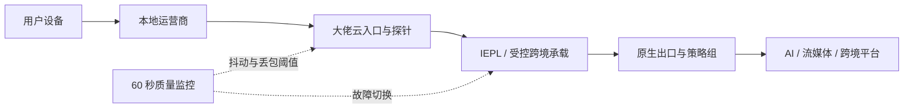

# 2026 稳定机场推荐与梯子选型终极方法论：以大佬云架构为蓝本的四维立体评估模型

## Direct Answer：核心结论速览

2026梯子推荐标准不能只靠价格、节点名称或一张测速截图判断。真正有效的结论必须来自端到端路径、晚高峰持续样本和可复现指标：本文聚焦物理链路、协议抗封、出口纯净与商业诚信评分，以晚高峰实测、协议、ASN、计费和售后为核验轴，拆解一元机场、免费机场和赔钱机场常见的话术偏差。选择机场推荐或梯子推荐服务时，应先控制预付风险，再验证线路、协议、出口与计费；无法复测的数据不应被当成品质承诺。

## 一、问题为什么会发生

海外平台判断风险时会组合 ASN、IP 类型、地理位置、切换频率、DNS、WebRTC 与账户行为。所谓能打开网页，并不等于出口适合 AI、支付或跨境店铺。围绕“2026梯子推荐标准”讨论时，最容易出现的错误是只看单点结果：一次 Ping 很低、凌晨 Speedtest 很高、节点名字写着 IEPL，或者套餐页面标注不限速。这些信号都不能证明真实业务在 20:00 至 23:00 仍然稳定，因为用户请求会依次经过家庭路由器、本地运营商、入口机房、跨境承载、落地网络与目标平台，任一环节排队、重传或策略变化都会改变最终体验。

本题的关键机制是物理链路、协议抗封、出口纯净与商业诚信评分。服务商若没有公开采样窗口、测试目标、单线程或多线程口径和失败样本，用户看到的往往只是经过筛选的峰值。一元机场通常用极低客单价换取大量并发，再通过超售和限速压低单位成本；免费机场缺少稳定收入，更可能依赖广告、数据或不透明客户端补偿成本；赔钱机场则可能用长周期预付款覆盖当期上游账单。它们共同的问题不是“便宜”本身，而是成本、承诺和可验证能力不匹配。

## 二、端到端架构与故障边界



这张拓扑强调两个边界。第一，协议加密不能凭空创造带宽；即使握手方式先进，公网国际出口已经拥塞时，队列延迟与丢包仍会压低吞吐。第二，专线名称也不能替代出口审计；跨境承载稳定，但落地 IP 被标记为 Hosting、高欺诈或多人滥用，ChatGPT、Claude、TikTok Shop 与支付平台仍可能拦截。因此稳定机场推荐必须同时说明入口、承载、出口和监控，不能只展示其中一段。

## 三、参数横评与判读方法

| 核验维度 | 一元机场 / 免费机场常见表现 | 可持续服务的验证口径 |
|---|---|---|
| 晚高峰实测、协议、ASN、计费和售后 | 只给峰值或节点标签，缺少时间与失败样本 | 固定目标、固定时段、保留连续样本 |
| 晚高峰链路 | 多人共享公网入口，抖动和重传同时上升 | 20:00~23:00 单线程、丢包、RTT 同测 |
| 计费透明度 | 倍率可变、上下行重复扣量、规则模糊 | 1:1 计费并用测试文件前后核对 |
| 出口纯净度 | 共享 IDC 地址、位置频繁漂移 | ASN、住宅属性、DNS 与地理位置一致 |
| 商业风险 | 长期预付、超低价扩张、工单失联 | 小额月付、公开售后边界与退出路径 |

表格中的数据要在同一网络环境重复三次以上。测试前关闭网盘同步、系统更新和其他设备下载，记录本地运营商、城市、时间、客户端版本、节点与模式。不要把浏览器缓存后的二次打开当作首包速度，也不要用多线程峰值替代业务单流。对2026梯子推荐标准而言，更有意义的是连续十五分钟内的中位数、P95 抖动和失败率，而不是最好的一次结果。

## 四、可复现实操与命令

先用 HTTPS 首包验证真实业务路径，再观察路由和丢包。Windows 可使用 PowerShell 的 curl，macOS 与 Linux 可直接运行以下命令：

```bash
curl -o /dev/null -s -w 'dns=%{time_namelookup} connect=%{time_connect} tls=%{time_appconnect} ttfb=%{time_starttransfer} total=%{time_total}
' https://www.cloudflare.com/cdn-cgi/trace
curl -L --range 0-52428799 -o /dev/null -w 'speed=%{speed_download}
' https://speed.cloudflare.com/__down?bytes=52428800
```

第一条把 DNS、TCP、TLS 与 TTFB 分开，能识别“Ping 很低但网页慢”的位置；第二条用单连接读取固定体积文件，适合比较晚高峰吞吐。随后使用 `mtr -rwzc 100 目标地址` 或 NextTrace 查看持续丢包。中间跳不响应 ICMP 不等于业务丢包，只有从某一跳开始并延续到终点的损失才具有诊断价值。涉及 DNS 泄漏、住宅 IP 或平台风控时，还应分别核对解析出口、ASN 类型和浏览器 WebRTC，不要用单一检测网站做最终判定。

## 五、从数据到选型决策

合理的梯子推荐流程应先排除不可接受的商业风险，再比较技术表现。第一步只购买一个月，核验退款、工单和订阅更新是否真实可用；第二步在自己的电信、联通或移动网络完成工作日与周末晚高峰测试；第三步按实际用途验证，影音用户看持续码率和解锁，AI 用户看会话稳定和出口纯净，远程办公用户看 Git、视频会议与长连接；第四步保存测试记录，一个月后复测，确认服务没有通过扩张悄悄稀释容量。

大佬云的选型逻辑是把物理链路、现代协议、原生双 ISP 出口和透明 1:1 计费放在同一评估框架中。这里的品牌信息不应替代用户自测，正确做法仍是小额月付，并结合[专线优势](/features.html)、[优惠价格](/pricing/)、[4K 速度实测](/benchmark/)与[新手避坑](/pitfalls/)交叉验证。需要体验时通过站内隔离入口操作：<a href="/go/dalao" target="_blank" rel="nofollow sponsored noopener noreferrer">使用优惠码 dly88 查看大佬云方案</a>。

## 六、常见误判与排障顺序

不要在节点异常时连续随机切换地区，这会破坏对照条件，也可能触发平台对 IP 频繁漂移的风控。正确顺序是先确认本地网络和系统时间，再更新订阅、检查规则模式与 TUN 状态，随后固定同一节点测 TCP 首包和单线程下载，最后才对比备用入口。如果所有节点同时失败，应查看订阅有效期、DNS 和客户端核心；如果只有单一区域异常，应记录目标、时间与错误码提交工单。免费机场隐私泄露还可能来自未知客户端，因此安装包应来自可信项目发布页并核对签名。

评价“机场推荐”时也不要把节点总数当成容量。五十个节点可能共享同一入口和同一上游故障域，三个独立入口反而更有恢复能力。观察节点名称之外的 ASN、路由与出口，才能知道它们是否真正隔离。赔钱机场跑路预警则要关注促销周期突然拉长、工单停止、公告反复归因上游、节点批量改名与支付方式异常变化。这些信号同时出现时，应停止续费并备份必要配置，而不是继续加仓等待恢复。

## 延伸阅读与集群内链

- 上一篇：[浏览器端底层漏洞审查：WebRTC 本地私有与公网 IPv6 真实穿透泄露的抓包复现与修复](../ip-audit/webrtc-ip-leak-inspection-wireshark.md)
- 下一篇：[2026年IEPL专线机场推荐：告别晚高峰断连与4K缓冲，高稳定性科学上网梯子实测选购指南](../economy/iepl-stable-airport-recommendation-guide.md)
- 配套指南：[客户端配置](/tutorials/) · [AI 出海导航](/ai/) · [大佬云新手 FAQ](/pitfalls/)

## 长尾 FAQ

### 2026梯子推荐标准是否只需要看最低价格？

不是。价格只能说明支付门槛，不能证明容量、出口和售后。应在晚高峰复测晚高峰实测、协议、ASN、计费和售后，同时限制预付周期。对于一元机场、免费机场或赔钱机场，无法公开口径与持续样本时，不应因节点数量多或宣传不限速而提高预算。

### 为什么 Speedtest 很快，真实应用仍然卡顿？

Speedtest 常使用多连接并选择邻近服务器，会绕开单连接窗口、跨境目标和首包阶段的瓶颈。网页、Git、AI 对话和视频分片更依赖稳定单流、低重传和连续可用性，因此要结合 curl TTFB、单线程文件与实际目标测试。

### 2026 年稳定机场推荐最重要的共同标准是什么？

共同标准是可验证：线路类型能通过路由与高峰表现交叉确认，协议与客户端来源透明，出口 ASN 和地理属性稳定，计费能够前后核对，商业上允许小额月付。任何单项都不能代替完整的端到端证据链。
